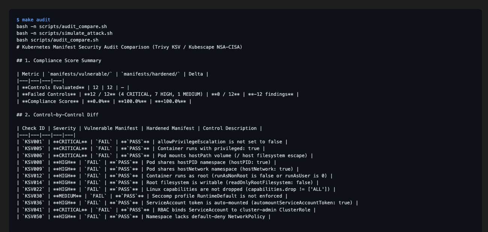

# k8s-hardening-falco: Kubernetes Workload Hardening & Falco Runtime Security Lab

## Why I built this
Getting a container running in Kubernetes is easy, but default deployments often leave huge security gaps: pods running as `root`, writable root filesystems, auto-mounted ServiceAccount tokens, overly broad RBAC bindings, and flat pod networks where any pod can talk to any other pod. Even after you lock down the YAML manifests, static hardening alone cannot detect an attacker who exploits an application-layer bug inside a running container.

I built this lab to combine both layers of Kubernetes defense:
1. **Pre-deployment manifest hardening**: Comparing an intentionally insecure deployment ([manifests/vulnerable/deployment.yaml](manifests/vulnerable/deployment.yaml)) against a hardened deployment ([manifests/hardened/deployment.yaml](manifests/hardened/deployment.yaml)) across 12 Trivy KSV / Kubescape NSA-CISA controls (`0.0%` compliance to `100.0%` compliance).
2. **Post-deployment runtime detection**: Writing custom **Falco** rules ([falco/custom_rules.yaml](falco/custom_rules.yaml)) that watch kernel system calls to alert the moment an attacker spawns an interactive shell, reads `/etc/shadow`, or opens an unexpected outbound network connection from a payment pod.

## What I hardened between `manifests/vulnerable/` and `manifests/hardened/`
Running `make audit` executes [scripts/audit_compare.sh](scripts/audit_compare.sh) and writes the full before/after report to [reports/audit_comparison.md](reports/audit_comparison.md).

| Check ID | Severity | Vulnerable (`payments-vuln`) | Hardened (`payments-hardened`) | Why it matters & how I fixed it |
|---|---|---|---|---|
| `KSV001` | **CRITICAL** | `FAIL` (`allowPrivilegeEscalation: true`) | **`PASS`** | Set `allowPrivilegeEscalation: false` so child processes cannot gain more privileges than their parent (blocks SUID binaries). |
| `KSV005` | **CRITICAL** | `FAIL` (`privileged: true`) | **`PASS`** | Set `privileged: false`; a privileged container has direct access to host devices and kernel capabilities. |
| `KSV006` | **CRITICAL** | `FAIL` (`hostPath: /` mounted at `/host`) | **`PASS`** | Removed `hostPath` mount of the node root filesystem and mounted an ephemeral `emptyDir: {}` at `/tmp` instead. |
| `KSV008` | **HIGH** | `FAIL` (`hostPID: true`) | **`PASS`** | Set `hostPID: false` so the pod cannot inspect or signal processes running on the worker node. |
| `KSV009` | **HIGH** | `FAIL` (`hostNetwork: true`) | **`PASS`** | Set `hostNetwork: false` to isolate the pod from the node's network interfaces and loopback ports. |
| `KSV012` | **HIGH** | `FAIL` (`runAsUser: 0` / root) | **`PASS`** | Enforced `runAsNonRoot: true` and `runAsUser: 10001` at both pod and container levels, plus namespace label `pod-security.kubernetes.io/enforce: restricted`. |
| `KSV014` | **HIGH** | `FAIL` (`readOnlyRootFilesystem: false`) | **`PASS`** | Set `readOnlyRootFilesystem: true` so an attacker cannot drop binaries or modify application code on disk (using the `/tmp` `emptyDir` for scratch writes). |
| `KSV022` | **HIGH** | `FAIL` (default capabilities kept) | **`PASS`** | Dropped all Linux capabilities (`capabilities: { drop: ["ALL"] }`). |
| `KSV030` | **MEDIUM** | `FAIL` (no Seccomp profile) | **`PASS`** | Set `seccompProfile: { type: RuntimeDefault }` to filter dangerous kernel syscalls. |
| `KSV036` | **HIGH** | `FAIL` (`automountServiceAccountToken: true`) | **`PASS`** | Created dedicated `payment-api-sa` with `automountServiceAccountToken: false` so no bearer token is mounted inside the pod filesystem. |
| `KSV041` | **CRITICAL** | `FAIL` (`ClusterRoleBinding` to `cluster-admin`) | **`PASS`** | Replaced cluster-wide `cluster-admin` with a namespace-scoped `Role` (`payment-config-reader`) allowing only `get`/`list` on a single named ConfigMap (`payment-api-config`). |
| `KSV050` | **HIGH** | `FAIL` (no `NetworkPolicy`) | **`PASS`** | Added `default-deny-all` (Ingress + Egress) plus `allow-gateway-to-payment-api` allowing TCP `:8080` only from `app: api-gateway` pods and UDP `:53` egress to `kube-dns`. |

## Custom Falco runtime rules (`falco/custom_rules.yaml`)
Even a pod that passes all 12 static checks above could still suffer an application-layer RCE bug. I wrote three Falco rules in [falco/custom_rules.yaml](falco/custom_rules.yaml) and paired them with [scripts/simulate_attack.sh](scripts/simulate_attack.sh):
1. **`K8s Interactive Shell Spawned in Container` (`WARNING`, MITRE `T1609`)**: Alerts when `spawned_process` inside a container runs `sh`, `bash`, `ash`, `zsh`, or `dash` (excluding container runtime init processes).
2. **`K8s Container Read Sensitive Shadow File` (`CRITICAL`, MITRE `T1003.008`)**: Alerts on any `open_read` syscall targeting `/etc/shadow` by a non-PAM process.
3. **`K8s Unexpected Outbound Connection from Payment Pod` (`ERROR`, MITRE `T1071`)**: Alerts when a pod labeled `app=payment-api` initiates an outbound connection on any port other than DNS (`53`).

### Static audit comparison output


## How to run it
```bash
# Run the static manifest audit comparator and generate reports/audit_comparison.md
make audit

# Optional: Spin up the 2-node kind cluster and deploy the manifests
make cluster-up
make deploy-vuln
make deploy-hardened
make cluster-down
```
